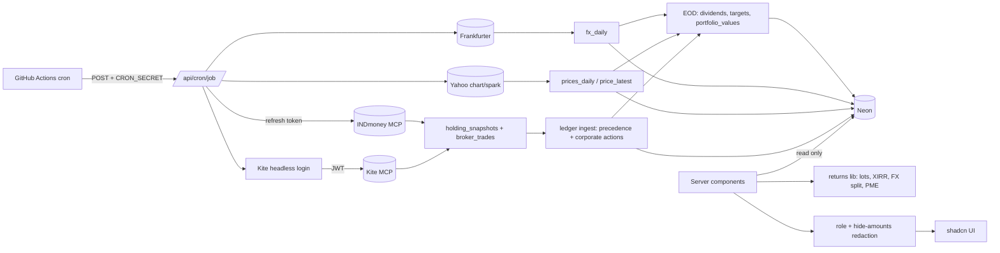
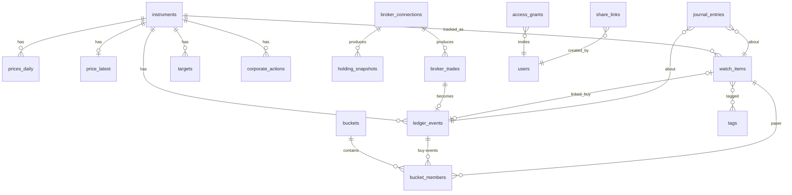
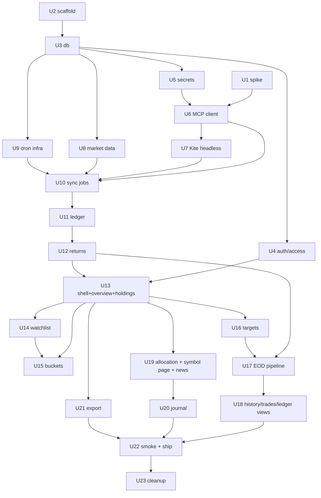

# feat: Stockboard rewrite — Next.js + Neon, MCP-client ingestion for Kite and INDmoney

**Target repo:** `nitin-1926/stockboard` (new, public). Built locally at `Projects/stockboard-new`, renamed to `Projects/Stockboard` in U23 after the old Flask directory is deleted.

## Summary

This is a from-scratch, free-tier portfolio tracker. It ingests Indian holdings from Kite and US holdings from INDmoney through a deterministic server-side MCP client, with no LLM involved. On top of that ingestion it builds:

- a ledger of buys, sells and corporate actions
- many-to-many buckets that hold both real positions and paper ones
- a unified watchlist that records the price when each stock was added
- multi-target tracking, with a scorecard for targets the manager sets
- FX-correct returns, including XIRR and benchmark alpha
- analytics views

The owner has full control. Contributors can add suggestions. Viewers can only read.

---

## Problem Frame

The existing app is a Flask service on Fly.io with Supabase behind it. It has six problems:

- **It is not free.** Fly has no free tier, and the Exa news API is paid.
- **Read-only sharing is broken.** `_owner_only` is defined but never called, so a magic-link holder can write credentials and mint new links.
- **US data is scraped.** It uses an unofficial INDmoney endpoint and grabs the token with a bookmarklet.
- **Each stock fits in only one bucket**, and sold positions vanish from history. That makes an honest "manager's picks vs mine" comparison impossible.
- **USD cost basis is converted at today's FX rate**, which hides currency gains.
- **There is no watchlist, no time-based targets and no history.**

The owner wants three things: a combined view of Indian and US holdings, a trustworthy comparison of manager-suggested vs self-picked returns, and a link to share with a finance manager, all at zero running cost.

---

## Requirements

**Platform and access**
- R1. Next.js (App Router) + React + TypeScript + shadcn/ui + Tailwind v4 on Vercel Hobby. Neon Postgres. Public GitHub repo with fresh history.
- R2. Google OAuth sign-in. `OWNER_EMAIL` (gupta7nitin@gmail.com) gets full access.
- R3. Three roles:
  - Owner: everything.
  - Contributor: invited email. Reads everything, and can create watch items, targets and bucket entries, auto-stamped `set_by = their email`.
  - Viewer: invited email, or an anonymous share link. Read-only.
- R4. Every grant has an expiry, can be revoked, and has a "hide amounts" option (percentages and prices only, no quantities or ₹/$ totals). Share links are viewer-only, and only a hash of the token is stored.

**Ingestion**
- R5. The server is the MCP client for Kite MCP and INDmoney MCP. No LLM sits on the data path.
- R6. Kite logs in headlessly each day using an encrypted Zerodha password and TOTP secret. A manual "Reconnect" fallback and a stale badge cover failures.
- R7. INDmoney is authorized once by OAuth and then kept alive with refresh tokens.
- R8. All secrets are encrypted with AES-256-GCM, and the key lives only in Vercel env. Credentials are write-only from the UI.
- R9. Ingestion covers holdings, positions (T+1), margins, the day's trades, and broker watchlists where a tool exists. Equities and ETFs only: Kite for India, INDmoney for US.
- R10. GitHub Actions cron calls authenticated job endpoints. Jobs: Kite login + sync, Kite post-close sync, INDmoney sync, intraday price refresh, EOD pipelines.
- R11. Prices come from Yahoo as primary, with MCP quotes as fallback. FX comes from Frankfurter. News comes from Google News RSS. Pages read prices from the DB.

**Domain**
- R12. The ledger uses this source precedence: broker fills > Console tradebook CSV > inference from sync diffs (flagged approximate). It is aware of splits and bonuses.
- R13. Buckets are many-to-many over real buy lots and watch items (paper). Each bucket shows absolute return, XIRR, realized + unrealized P&L, dividends, and alpha vs Nifty 50 / S&P 500 on the same cash flows.
- R14. One unified watch-item model:
  - the price at add is captured automatically
  - tags replace multiple lists
  - a watch item auto-links to a later buy
  - broker watchlists are imported where available
- R15. Each symbol can have several targets:
  - kind is target or stop
  - the price is absolute or a % of the price when set
  - an optional deadline
  - `set_by`, plus the price and time when set
  - a lifecycle evaluated at EOD, with history kept
  - a manager scorecard built from them
- R16. FX is computed properly. A US lot's INR cost uses USD/INR on its buy date. Views show USD return, INR return and the FX contribution. Combined math is in INR.
- R17. Extras: value history chart, daily P&L heatmap, dividends, trade journal, concentration and allocation views, and an LTCG countdown badge (India 12 months, US 24 months).
- R18. Carried over from the old app:
  - Overview with India/US sections, totals and an allocation donut.
  - Sortable holdings table with market and bucket tabs, T+1 badge, upside %, held duration.
  - Margins, per-stock news, and CSV/XLSX export.

**UI and process**
- R19. Hybrid UI:
  - dark and light themes that follow the system
  - a calm Overview and dense tables
  - Geist Sans + Geist Mono with tabular figures
  - a colorblind-safe palette option, with ▲/▼ glyphs so meaning never depends on color alone
  - responsive down to phone width
  - Load the design-taste-frontend and ui-ux-pro-max skills before any UI unit.
- R20. Repo process:
  - DEVLOG.md (setup-devlog) and ADRs in `docs/adr/`.
  - vitest for the financial math, ledger, permissions and crypto, plus one Playwright smoke test.
  - Nothing of the old Flask app survives in the new repo or locally.

---

## Scope Boundaries

- No order placement, GTT, alerts or any other write action against a broker. Request only read scopes, and never call `orders` in place/modify/cancel modes.
- No mutual funds, and no Indian holdings on INDmoney. An `asset_class` column is kept so these can be added later.
- No per-bucket visibility scopes for viewers.
- No migration of data from the old Supabase project.
- No LLM features.

### Deferred to Follow-Up Work

- Telegram alerts (target hit, stop triggered, deadline approaching, headless login failure)
- Weekly digest email
- Claude weekly review via `claude -p`, using the claude-code-backend skill
- Installable PWA

---

## Context & Research

### Relevant Code and Patterns (old app, captured here because it gets deleted in U23)

- **Headless Kite login chain** (old `do_login_for_user`):
  1. POST `kite.zerodha.com/api/login` (user_id, password) → `request_id`
  2. POST `/api/twofa` (`twofa_type=totp`, `twofa_value` = current TOTP)
  3. GET `connect/login?v=3&api_key=…` and follow redirects until `request_token` appears

  The user agent was `Mozilla/5.0`. This is reused against Kite MCP's own api_key; see the chain under External References.
- **T+1 merge rule** (old `fetch_holdings_for_user`):
  - If a holding's `t1_quantity` > 0, add it to quantity and flag `t1_pending`.
  - Append net positions with `product == CNC`, `quantity` > 0, that are absent from holdings, also flagged `t1_pending`.
- **The old US mapping is wrong.** INDmoney returned `todays_profit_loss` as position-level P&L, but the old code treated it as per-share. The new mapping must take its field semantics from the U1 fixtures.
- **Holdings Excel columns:** Symbol, Exchange, Qty, Avg Cost, LTP, Invested, Value, P&L, Return %, Day P&L, plus a Summary sheet.

### Institutional Learnings

- There is no `docs/solutions/` folder. This is a greenfield repo.

### External References (researched 2026-11-11)

**Kite MCP** (`zerodha/kite-mcp-server` `develop` branch; hosted `mcp.kite.trade` matches it)
- Auth flow:
  - DCR `POST /register` returns a stateless, signed `client_id` that never expires, so register once.
  - Allowed redirect URIs: https anywhere, or http on loopback only. Rate limit is 10/min.
  - `GET /authorize` serves a consent page and sets cookie `__Host-kite-consent-*`. `POST /authorize` (approve) returns a 303 to `kite.zerodha.com/connect/login` using the server's own api_key and sets cookie `__Host-kite-state-*`.
  - Kite redirects back to `mcp.kite.trade/callback`, which 302s to our `redirect_uri` with `?code` (10-minute lifetime).
  - `POST /token` (PKCE) returns a JWT that lasts up to 7 days. There is **no refresh token**.
- Session expiry: the underlying Kite session dies at the next **06:00 IST**. After that, tool calls return `isError` with the text "kite session has expired". The JWT itself does not get a 401.
- Grants are held in memory, so a server restart forces a fresh login.
- Tools are grouped and selected with a `mode` argument:
  - `portfolio`: holdings, positions, margins, profile
  - `orders`: list, trades, history
  - `market`: quote, ltp, ohlc, historical, search
  - `mutual_funds`, `session`
- There is **no watchlist tool**.
- Tools return `structuredContent` plus JSON text. Lists come wrapped as `{data, pagination}`. Check `isError` first.

**INDmoney MCP** (`mcp.indmoney.com/mcp`)
- DCR is supported, as a confidential client (`client_secret_post`/`client_secret_basic`).
- Grants: `authorization_code` and `refresh_token`. Scopes: `portfolio:read`, `market:read`, `insights:write`. Request only the read scopes.
- Login is mobile + OTP + MPIN, so it is interactive once.
- Reportedly 14 read-only tools, covering portfolio, positions, watchlists, quotes, candles and US stock data. The tool list is unverified.

**MCP TypeScript SDK**
- v1 is `@modelcontextprotocol/sdk` 1.32.2. v2 is the split packages, e.g. `@modelcontextprotocol/client` 2.4.0, stable since 2026-07; it targets the 2026-07-28 stateless Streamable HTTP spec.
- `OAuthClientProvider` methods: `clientInformation`/`saveClientInformation`, `tokens`/`saveTokens`, `codeVerifier`/`saveCodeVerifier`, `redirectToAuthorization`, `invalidateCredentials`. v2 also has a minimal `AuthProvider {token()}`.
- The SDK refreshes only after a 401.
- In serverless, use one client per request: connect, call, then `close()` in `finally`.

**Platform**
- Next.js 16.4:
  - `cacheComponents` is on by default: data is dynamic unless marked `'use cache'` + `cacheLife`.
  - `middleware` is renamed `proxy`. Segment `runtime`/`revalidate` exports are not allowed.
  - Cron handlers should be POST.
- Vercel Hobby: Fluid compute with a 300s function maximum, 2 GB memory, non-commercial use only.
- Better Auth 1.7: Auth.js joined Better Auth in 2025-09 and is now maintenance-only.
  - Google provider via `socialProviders`.
  - Drizzle adapter.
  - Role assignment goes in a `databaseHooks.user.create.before` gate. An `after` hook does not block sign-up.
- Drizzle 0.45 + `@neondatabase/serverless` 1.2:
  - `neon-http` has **no interactive transactions**. Use the `neon-serverless` Pool for sync writes, plus `attachDatabasePool`.
  - Run migrations against `DATABASE_URL_UNPOOLED`.
- Neon via `vercel integration add neon`. Free tier: 1 GB per project, 100 CU-hours per month, scales to zero after 5 minutes idle.
- GitHub Actions: schedules can be delayed, the minimum interval is 5 minutes, and **scheduled workflows are disabled after 60 days without repo activity**.
- shadcn CLI 4.x with Tailwind 4.3, oklch CSS variables, Recharts v3 charts, `next-themes`, and `next/font` Geist.

**Market data** (live-tested 2026-11-11)
- Yahoo v8 `chart` and v7 `spark` (batch) need no crumb, but **do need a short browser User-Agent**; curl's default UA gets 429.
  - `quoteSummary` and v7 `quote` need the cookie+crumb flow: `fc.yahoo.com` sets cookie `A3`, then `/v1/test/getcrumb`.
  - `close` is already split-adjusted, so history must use cumulative-factor-adjusted quantities.
  - **Bonuses appear as splits**: RELIANCE's 1:1 bonus shows as "2:1".
  - Event dates come from `date`, not the object key.
  - `.BO` history is unreliable, so prefer `.NS`. Renamed symbols (TATAMOTORS, MCDOWELL-N) return 404 and need an override table. URL-encode `&` (as in `M%26M.NS`).
  - Yahoo rate limits are per IP and stricter for datacenter IPs. So fetch on cron, store in the DB, and serve from the DB.
- Frankfurter v1 (ECB): `/v1/latest`, `/v1/<date>` (falls back to the previous business day) and time series (weekends omitted, so forward-fill).
- Google News RSS: `news.google.com/rss/search?q="<company>"+when:7d&hl=en-IN&gl=IN&ceid=IN:en`, or the US locale. Quote the company name rather than the bare ticker.
- XIRR: hand-roll it (Newton, falling back to bisection on [-0.9999, 10]). Return null without mixed-sign flows. Show absolute return for holdings under 365 days.
- Benchmark: Long-Nickels PME. Replicate each cash flow as index units on the same dates (S&P units bought through USDINR), using NIFTYBEES/SPY `adjclose` as a total-return proxy.
- Tax: listed Indian equity is long-term after more than 12 months. Foreign shares held by a resident are long-term after more than 24 months (Budget 2024, carried into the Income-tax Act 2025). Bonus shares are new lots with zero cost, dated from allotment.

---

## Key Technical Decisions

Each decision gets an ADR in `docs/adr/` during the unit that introduces it.

- **The server is the MCP client, with no LLM on the data path.** Calls are deterministic `callTool` requests, so financial numbers never pass through model parsing and it runs on Vercel for free. Claude is not needed. (ADR-0001)
- **MCP SDK v2 (`@modelcontextprotocol/client`), with one client per request.** Kite already supports the stateless 2026-07-28 protocol. If U1 finds INDmoney incompatible, pin v1 `@modelcontextprotocol/sdk` for both servers rather than mixing lines.
- **Kite auth uses a stored JWT, not an OAuth provider.** No refresh token exists. The daily headless chain mints a JWT, a simple token provider injects it, and the `"kite session has expired"` `isError` text marks the connection stale. (ADR-0002, which documents that the user accepted Zerodha's discouragement)
- **INDmoney auth uses a DB-backed `OAuthClientProvider`.** It stores the confidential client secret, tokens and code verifier encrypted. Refreshes are serialized per connection with a row lock, so concurrent cron and page calls can't double-spend a rotating refresh token.
- **Better Auth over Auth.js.** Auth.js is maintenance-only and next-auth v5 never left beta. A `user.create.before` hook rejects any Google account that is neither `OWNER_EMAIL` nor an active grant. (ADR-0003)
- **Roles are resolved on every request, not trusted from the stored user row.** Revoking or expiring a grant takes effect immediately, and the owner is decided by the env email, so the DB can never promote anyone to owner.
- **Share links live outside Better Auth.** Visiting `/s/<token>` hashes the token, looks it up, and sets a short-lived signed httpOnly cookie carrying the link id. Every request re-checks revocation and expiry.
- **"Hide amounts" is enforced on the server by redacting DTOs.** It is not CSS: quantities and currency totals never reach a restricted client's payload.
- **Drizzle with two drivers.** `neon-http` for reads; `neon-serverless` Pool for the multi-statement sync and ledger writes that need transactions. (ADR-0004)
- **The ledger is event-sourced and lots are derived.** `ledger_events` (buy, sell, split, bonus, dividend) are the source of truth. Lots, realized P&L and tax lots come from a pure FIFO replay, which is testable, recomputable and makes corrections cheap. (ADR-0005)
- **Source precedence is applied when events are ingested.**
  - A broker fill for a symbol and date supersedes any inferred event that covers the same quantity change.
  - A CSV import supersedes inferred events in its date range.
  - Superseded events are kept and marked, never deleted.
- **A sync diff is checked against corporate actions before it is treated as a buy.** A quantity ratio that matches a Yahoo split event on that date, with qty × avg unchanged within about 0.5%, is a corporate action. Bonus vs split is ambiguous (Yahoo reports bonuses as splits), so the event defaults to "split" and the owner can reclassify it as a bonus, which spawns a zero-cost lot dated at allotment.
- **Prices are served from the DB, refreshed by cron.** Every ~15 minutes during each market's hours, via a Yahoo `spark` batch. Pages read from `price_latest`, and the owner has a "refresh now" action. MCP quotes are a per-symbol fallback when Yahoo fails or 429s. This avoids per-page Yahoo calls from datacenter IPs. (ADR-0006)
- **FX method.**
  - The ECB rate from Frankfurter v1 is stored daily, with weekends forward-filled.
  - A US lot's INR cost = native cost × the rate on the buy date.
  - INR return − USD return = FX contribution.
  - Holdings that predate the ledger use the first-sync date and carry an `approximate` flag until the owner edits the date or imports trades. (ADR-0007)
- **Returns math is pure and lives in its own module**, with no I/O, so it is unit-tested exhaustively. Holdings under 365 days show absolute return instead of XIRR.
- **Bucket membership attaches to buy events and watch items, not to symbols.** A re-buy can therefore land in a different bucket. When a new buy is ingested, it inherits the buckets of that symbol's currently open lots; the owner can reassign.
- **Watch items and paper bucket members are the same table.** Buckets reference watch items directly. When a buy is ingested for a watched symbol, the watch item gets a link to that buy event and stays visible, so the "watchlisted at X, bought at Y" comparison works.
- **Cron runs in GitHub Actions, not on Vercel.** Each job is a POST to `/api/cron/<job>` with a `CRON_SECRET` bearer, compared in constant time. A monthly keepalive workflow re-enables the scheduled workflows through the GitHub API, which beats the 60-day auto-disable.
- **Every job writes a `sync_runs` row** (running → completed/failed, counts, error). It is the only observability, and the dashboard reads it for stale and error badges.
- **Deploy via the Vercel CLI at the end of every phase.** It is independent of git pushes, so the owner sees progress while CLAUDE.md's no-commit-without-approval rule still holds.

---

## Open Questions

### Resolved During Planning

- **Auth library:** Better Auth, for the maintenance-status reasons above.
- **ORM and driver:** Drizzle, with `neon-http` and `neon-serverless` used side by side.
- **Can the Kite MCP OAuth chain run headless?** Yes, in principle. Every binding is a cookie on `mcp.kite.trade`, so one cookie jar can drive consent, the Kite login and the redirects, then read `code` from the `Location` header without running a listener. U1 proves it.
- **Kite watchlist sync:** there is no tool for it, so Kite watchlists come in by paste-symbols import only. INDmoney reportedly has watchlists; U1 confirms.
- **Where daily trades come from:** the Kite `orders` tool in `trades` mode at 15:45 IST. U1 confirms whether INDmoney has an equivalent tool.
- **Which sell price inference uses:** the day's close, flagged approximate. It is superseded once a fill or CSV row arrives.

### Deferred to Implementation

These all depend on runtime behavior.

- **INDmoney MCP:**
  - exact tool names, argument schemas and output schemas
  - access and refresh token lifetimes
  - whether DCR accepts our https and loopback redirect URIs
  - which MCP protocol version it negotiates

  U1 captures all of this as fixtures.
- **Hosted Kite MCP's `EXCLUDED_TOOLS`:** whether `orders` `trades` mode is available on the hosted read-only deployment.
- **Kite's first-time login screen:** whether the first use shows a one-time "authorize app" screen on Kite. If so, the first login is done manually in a browser.
- **Yahoo from Vercel IPs:** how often it 429s. That decides whether the MCP quote fallback gets used routinely, or whether the price cron should run inside the GitHub Actions runner and POST the results.
- **Symbol search for adding watch items:** Yahoo's `/v1/finance/search` (crumb-free?) vs Kite `market` `search` mode.
- **Exact `cacheLife` profiles** for news and per-stock pages.

---

## Output Structure

    stockboard/
    ├── .github/workflows/          # cron-*.yml (one per job), keepalive.yml, ci.yml
    ├── docs/
    │   ├── adr/                    # 0001…0007 + template
    │   ├── plans/                  # this plan
    │   └── spikes/                 # mcp-findings.md
    ├── drizzle/                    # generated SQL migrations
    ├── scripts/spike/              # U1 throwaway probes (kept for reference)
    ├── e2e/                        # Playwright smoke
    ├── src/
    │   ├── app/
    │   │   ├── (app)/              # authenticated shell: overview, holdings, watchlist,
    │   │   │                       #   buckets, targets, trades, ledger, history,
    │   │   │                       #   allocation, symbol/[id], settings/*
    │   │   ├── s/[token]/          # share-link entry
    │   │   ├── sign-in/
    │   │   └── api/
    │   │       ├── auth/[...all]/
    │   │       ├── cron/[job]/
    │   │       ├── connect/indmoney/  # start + callback
    │   │       └── export/
    │   ├── components/             # ui/ (shadcn), charts/, tables/, layout/
    │   ├── db/                     # schema/*.ts, client-http.ts, client-pool.ts
    │   ├── lib/
    │   │   ├── auth/               # better-auth config, access.ts (role resolution, can()), redact.ts
    │   │   ├── crypto/             # secrets.ts
    │   │   ├── mcp/                # client.ts, kite/, indmoney/, schemas.ts
    │   │   ├── market/             # yahoo.ts, fx.ts, news.ts, symbols.ts
    │   │   ├── ledger/             # events.ts, infer.ts, corporate-actions.ts, lots.ts, csv-import.ts
    │   │   ├── returns/            # xirr.ts, pnl.ts, fx-returns.ts, benchmark.ts, tax.ts
    │   │   ├── targets/            # evaluate.ts, scorecard.ts
    │   │   └── jobs/               # registry.ts + one module per job
    │   └── proxy.ts
    ├── DEVLOG.md
    ├── README.md
    ├── LICENSE
    └── tasks/todo.md

Per-unit `**Files:**` lists are authoritative. The tree shows intended shape only.

---

## High-Level Technical Design

> *This illustrates the intended approach and is directional guidance for review, not implementation specification. The implementing agent should treat it as context, not code to reproduce.*

### Data flow



### Daily Kite headless chain

```mermaid
sequenceDiagram
  participant J as kite-login job
  participant M as mcp.kite.trade
  participant K as kite.zerodha.com
  J->>M: GET /authorize (client_id, redirect_uri, PKCE, state)
  M-->>J: consent HTML + consent cookie
  J->>M: POST /authorize approve (flow, csrf)
  M-->>J: 303 → K /connect/login?api_key=MCP_KEY…  (+ state cookie)
  J->>K: POST /api/login (user_id, password)
  J->>K: POST /api/twofa (TOTP)
  J->>K: GET /connect/login… (follow redirects, same jar)
  K-->>J: 302 → M /callback?request_token…
  M-->>J: 302 → our redirect_uri?code…   (read Location, stop)
  J->>M: POST /token (code, verifier)
  M-->>J: JWT (store encrypted + exp; valid until 06:00 IST Kite expiry)
```

### Core entities



Supporting tables:
- `fx_daily`
- `portfolio_values` (daily, per market and combined)
- `sync_runs`
- `settings` (concentration thresholds, palette, benchmark choices)
- Better Auth tables

### Unit dependency graph



---

## Phased Delivery

| Phase | Units | Ships | Deploy |
|---|---|---|---|
| 0. Spike | U1 | Go/no-go evidence for MCP ingestion | none |
| 1. Foundation + ingestion | U2–U10 | Login, sharing, both brokers syncing on cron, prices/FX in DB, a raw holdings page | `vercel deploy --prod` |
| 2. Core domain | U11–U16 | Ledger, returns, Overview/Holdings UI, watchlist, buckets, targets | deploy |
| 3. Analytics | U17–U21 | EOD pipeline, history/heatmap, trades/ledger views, allocation, symbol page + news, journal, export | deploy |
| 4. Ship + cleanup | U22–U23 | Smoke test, repo push (on owner approval), docs, old-directory deletion | final deploy |

---

## Implementation Units

### U1. Spike: prove MCP ingestion end to end

**Goal:** Turn every ingestion assumption into evidence before building on it. Kill or confirm the MCP-first approach.

**Requirements:** R5, R6, R7, R9

**Dependencies:** None. Runs as standalone scripts before the app exists.

**Files:**
- Create: `scripts/spike/kite-headless.ts`, `scripts/spike/indmoney-oauth.ts`, `scripts/spike/list-tools.ts`
- Create: `docs/spikes/mcp-findings.md`
- Create: `src/lib/mcp/__fixtures__/` (redacted sample `structuredContent` per tool and mode)

**Approach:**
- **Kite:**
  - Register a client once with a loopback redirect URI.
  - Run the headless chain from the sequence diagram using one cookie jar and the owner's real credentials, supplied through local env and never written to disk.
  - Capture `tools/list`, then call `portfolio` (holdings, positions, margins), `orders` (trades) and `market` (ltp) and save redacted outputs.
  - Record whether a first-time "authorize app" screen appears on Kite.
- **INDmoney:**
  - DCR with a loopback redirect, then an interactive browser consent (mobile/OTP/MPIN).
  - Capture the token response (record `expires_in` and refresh behavior), `tools/list`, and the outputs of holdings, watchlist, trades/transactions (if they exist) and quotes.
  - Exercise one refresh-token grant.
- Confirm the negotiated protocol version on both servers and whether MCP SDK v2 works against each.
- Write a findings doc covering:
  - the tool → field mapping per broker
  - token lifetimes
  - gaps
  - a **gate decision**: proceed MCP-first, or switch Kite to Kite Connect Personal REST. Either way the headless login is reused; only the token exchange changes.
- Update the "Deferred to Implementation" entries in this plan with the answers.

**Execution note:** Throwaway exploration. No tests. Fixtures are its durable output.

**Test scenarios:**
- Test expectation: none. This is a spike. Its fixtures feed U6 and U10 contract tests.

**Verification:**
- `docs/spikes/mcp-findings.md` shows a Kite token minted without human interaction and an INDmoney refresh that succeeded.
- Fixtures exist for every tool mode U10 needs.
- A go/no-go decision is written down.

---

### U2. Scaffold the repo and process

**Goal:** A fresh Next.js 16 app wired with shadcn, theming, fonts, testing and the process documents.

**Requirements:** R1, R19, R20

**Dependencies:** None (can run in parallel with U1)

**Files:**
- Create: `package.json`, `next.config.ts` (`cacheComponents` and an explicit `partialPrefetching` setting), `tsconfig.json`, `components.json`, `src/app/globals.css` (oklch tokens, gain/loss + colorblind palette tokens), `src/app/layout.tsx` (Geist fonts, ThemeProvider, `suppressHydrationWarning`)
- Create: `vitest.config.ts`, `playwright.config.ts`, `.env.example`, `.gitignore`, `README.md`, `LICENSE` (MIT, owner's name)
- Create: `DEVLOG.md` (via setup-devlog), `docs/adr/0000-template.md`, `tasks/todo.md`
- Create: `.github/workflows/ci.yml` (typecheck, lint, vitest)

**Approach:**
- Use `create-next-app` and `shadcn init` with a preset that has neutral base tokens. Remove any leftover `tailwind.config`.
- Gain/loss tokens: default green/red, plus a colorblind-safe blue/orange set switched by a `data-palette` attribute.
- Make sure no file, comment, README text, license holder or package name refers to the old Flask app.

**Patterns to follow:** shadcn Next installation docs; `next-themes` dark-mode guide.

**Test scenarios:**
- Test expectation: none. Scaffolding only. CI running vitest with zero tests counts as passing.

**Verification:**
- The app boots and renders a themed placeholder in both light and dark mode.
- Typecheck, lint and the vitest run all pass in CI.

---

### U3. Database: provision Neon, set up the Drizzle clients, foundational schema

**Goal:** Neon is reachable from local and Vercel, both drivers are configured, the migration workflow works, and the foundational tables exist.

**Requirements:** R1, R10, R11

**Dependencies:** U2

**Files:**
- Create: `drizzle.config.ts`, `src/db/client-http.ts`, `src/db/client-pool.ts`, `src/db/schema/index.ts`, `src/db/schema/market.ts` (instruments; prices_daily with open/high/low/close/adj_close, since U16 target evaluation needs the daily high/low; price_latest; fx_daily), `src/db/schema/ops.ts` (sync_runs, settings)
- Create: `drizzle/` (first migration)
- Test: `src/db/schema/market.test.ts` (constraint behavior against a Neon dev branch)

**Approach:**
- Link a Vercel project, run `vercel integration add neon`, then `vercel env pull`. Create a Neon `dev` branch for local work.
- `instruments` columns:
  - `market` (IN/US) and `exchange`
  - `broker_symbol`, `yahoo_symbol`, and `yahoo_symbol_override`
  - `name`, `sector`, `industry`, `market_cap`
  - `asset_class` (default `equity`)
  - unique on (market, broker_symbol)
- Use `numeric` for every money and quantity column, never float. Normalize every row to a currency plus native amounts.
- Migrations follow generate → migrate against the unpooled URL. Never use `push` against main.

**Patterns to follow:** Drizzle "connect Neon" docs; `attachDatabasePool` for the Pool on Fluid compute.

**Test scenarios:**
- Happy path: inserting an instrument and then a duplicate (market, broker_symbol) violates the unique constraint.
- Edge case: money and quantity columns round-trip values like `1234.5678` and `0.000123` exactly, with no float drift.

**Verification:**
- Migrations apply cleanly on both the dev branch and main.
- Both clients can query from a route handler deployed to Vercel.

---

### U4. Auth and access: Google sign-in, roles, grants, share links, redaction

**Goal:** Owner, Contributor and Viewer access with immediate revocation, plus anonymous share links and server-enforced "hide amounts".

**Requirements:** R2, R3, R4

**Dependencies:** U3

**Files:**
- Create: `src/lib/auth/config.ts` (Better Auth, Google, Drizzle adapter, `nextCookies` plugin last), `src/app/api/auth/[...all]/route.ts`, `src/db/schema/auth.ts` (generated by Better Auth plus `access_grants` and `share_links`)
- Create: `src/lib/auth/access.ts` (actor resolution: session or share-link cookie → {role, hideAmounts, email}; `can(actor, action)`), `src/lib/auth/redact.ts`
- Create: `src/proxy.ts` (cookie-presence redirect only), `src/app/sign-in/page.tsx`, `src/app/s/[token]/route.ts`
- Create: `src/app/(app)/settings/sharing/page.tsx` plus server actions (invite email with a role, mint link, revoke, set expiry and hide-amounts)
- Test: `src/lib/auth/access.test.ts`, `src/lib/auth/redact.test.ts`

**Approach:**
- The `user.create.before` hook allows `OWNER_EMAIL` or an email with an active, unexpired grant, and throws for anyone else.
- Actor resolution runs on every request:
  1. Owner if the session email equals `OWNER_EMAIL`, compared case-insensitively.
  2. Otherwise, the role from an active grant.
  3. Otherwise, no access: sign the user out.
- Share link:
  - The token is 32 random bytes, encoded base64url. Only its sha256 is stored.
  - The `/s/[token]` route sets a signed httpOnly cookie holding the link id, then redirects to the overview.
  - Every request re-validates the link.
- Actions:
  - `read` is open to every role.
  - `suggest` (create watch items, targets and bucket entries) is open to owner and contributor.
  - `manage` (credentials, sharing, deleting others' entries, ledger edits) is owner-only.
- Redaction runs in one place: the server-side mappers that build page DTOs. The share-link path can't skip it.

**Execution note:** Implement the access matrix test-first. It is the security boundary that the old app got wrong.

**Patterns to follow:** Better Auth Next integration and database hooks docs.

**Test scenarios:**
- Happy path: the owner email signs in and resolves to the owner role, with `can(manage)` true.
- Happy path: an invited contributor resolves to contributor, with `can(suggest)` true and `can(manage)` false.
- Happy path: a viewer link resolves to viewer, with `can(suggest)` false.
- Edge case: owner email in different case (`Gupta7Nitin@Gmail.com`) still resolves to owner.
- Edge case: a grant expired yesterday → the existing session resolves to no access on the next request.
- Error path: an uninvited Google account → sign-up rejected in `before`, and no user row is created.
- Error path: a revoked or expired share link → no access, and the cookie is cleared.
- Error path: a contributor calls the credential-save action directly → rejected on the server.
- Integration: a viewer with hide-amounts → the holdings DTO contains percentages and prices but no `quantity`, `invested` or `value` fields. The fields are absent, not zeroed.
- Integration: a share link can never resolve above the viewer role, even if its row were tampered with to say contributor.

**Verification:**
- Every cell of the matrix (roles × actions × grant states) is covered by tests and passes.
- Manual check: an uninvited Google account cannot get in.

---

### U5. Secrets and broker credentials

**Goal:** Encrypted storage for Zerodha credentials and every MCP client registration and token, behind a write-only settings UI.

**Requirements:** R6, R8

**Dependencies:** U3, U4

**Files:**
- Create: `src/lib/crypto/secrets.ts` (AES-256-GCM via `node:crypto`, random 12-byte IV, versioned envelope like `v1:<iv>:<tag>:<ct>`)
- Create: `src/db/schema/brokers.ts` (`broker_connections`: broker, status, last_sync_at, last_error, plus encrypted columns for Zerodha user id, password and TOTP secret, MCP client info, tokens and code verifier, and token_expires_at)
- Create: `src/app/(app)/settings/brokers/page.tsx` plus owner-only server actions
- Test: `src/lib/crypto/secrets.test.ts`

**Approach:**
- `ENCRYPTION_KEY` is 32 random bytes, base64-encoded, held in Vercel env only. Fail fast at boot if it is missing or the wrong length.
- The settings page shows only "set / last updated / status". Secrets can be replaced, never read back.
- Decryption happens only in job and MCP code paths. Decrypted values never reach a client component or the logs.

**Test scenarios:**
- Happy path: encrypt then decrypt round-trips ASCII and unicode secrets.
- Edge case: encrypting the same plaintext twice produces different ciphertexts.
- Error path: a single flipped byte in the ciphertext or tag → decrypt throws (auth failure). It never returns garbage, unlike the old code's silent fallback to plaintext.
- Error path: the wrong key → throws.
- Error path: a missing or short `ENCRYPTION_KEY` → a startup error naming the variable.

**Verification:**
- A DB dump shows only `v1:` envelopes.
- The credentials form saves new values, and no API ever returns them.

---

### U6. MCP client layer

**Goal:** One per-request MCP call helper and per-broker auth providers, with typed outputs parsed from the U1 fixtures.

**Requirements:** R5, R7, R9

**Dependencies:** U1, U5

**Files:**
- Create: `src/lib/mcp/client.ts` (connect → callTool → close in `finally`; `isError` → typed error; detects "kite session has expired" → `SessionExpiredError`)
- Create: `src/lib/mcp/kite/auth.ts` (token provider from the stored JWT), `src/lib/mcp/kite/tools.ts` (typed wrappers: holdings, positions, margins, trades, ltp)
- Create: `src/lib/mcp/indmoney/oauth-provider.ts` (DB-backed `OAuthClientProvider`; `redirectToAuthorization` stores the URL and throws `NeedsConsentError`; refresh serialized with a row lock), `src/lib/mcp/indmoney/tools.ts`
- Create: `src/app/api/connect/indmoney/route.ts` (owner starts the consent flow), `src/app/api/connect/indmoney/callback/route.ts` (`finishAuth` → status connected)
- Create: `src/lib/mcp/schemas.ts` (zod schemas derived from the fixtures)
- Test: `src/lib/mcp/client.test.ts`, `src/lib/mcp/schemas.test.ts`, `src/lib/mcp/indmoney/oauth-provider.test.ts`

**Approach:**
- Each wrapper returns normalized domain shapes:
  - `BrokerHolding {brokerSymbol, exchange, qty, t1Qty, avgPrice, ltp, currency}`
  - `BrokerTrade {tradeId, orderId, symbol, side, qty, price, executedAt}`
  - `BrokerWatchItem`
- Raw MCP shapes never leak past `lib/mcp`.
- Kite pagination: loop while `pagination.has_more`.
- A schema-validation failure is a loud error that names the tool and mode. Tool renames like the ones in the develop-branch refactor should fail visibly, not produce empty data.
- Only read tools and modes are allowlisted in the wrappers. Nothing else is callable.

**Patterns to follow:** U1 findings doc; MCP SDK v2 client docs.

**Test scenarios:**
- Happy path: each fixture parses into normalized shapes with correct numeric types.
- Edge case: a paginated Kite response with `has_more` across 2 pages → all items merged.
- Edge case: an empty holdings response → empty array, not an error.
- Error path: `isError` with the "kite session has expired" text → `SessionExpiredError`, which the caller maps to connection status `stale`.
- Error path: a fixture with a renamed field → a validation error naming the tool.
- Error path: INDmoney provider asked to authorize with no tokens → `NeedsConsentError`, and the authorization URL is persisted.
- Integration: two concurrent refreshes on the same connection → exactly one token request (row-lock serialization), and both callers get the new token.
- Integration: calling a write mode such as `orders` with mode `place` through the wrapper layer is impossible because it is not in the allowlist.

**Verification:**
- Real calls from a deployed route return normalized holdings for both brokers.
- The INDmoney connection survives an access-token expiry without human action.

---

### U7. Kite headless daily login

**Goal:** Mint a fresh Kite MCP JWT every morning with no human involved, plus a manual fallback.

**Requirements:** R6

**Dependencies:** U6

**Files:**
- Create: `src/lib/mcp/kite/headless-login.ts` (the cookie-jar chain from the sequence diagram; TOTP via `otplib`; stops at our `redirect_uri` by reading `Location`)
- Create: `src/lib/mcp/kite/manual-connect.ts` plus the `src/app/api/connect/kite/` start/callback routes (the owner completes the same flow in a browser)
- Test: `src/lib/mcp/kite/headless-login.test.ts` (against recorded HTTP fixtures from U1)

**Approach:**
- The client registration is stored once (stateless and non-expiring) and re-registered only if `/authorize` rejects it.
- Credentials are decrypted only inside this function.
- No retry loop on TOTP failure: one attempt per run. This avoids locking the account. Generate the TOTP immediately before posting `/api/twofa`. If the code is within 2 s of a 30 s window boundary, wait for the next window first.
- On success, store the encrypted JWT and its `exp`, and set status `connected`.
- On failure:
  - set status `login_failed` and record the redacted step name (consent / login / twofa / redirect / token)
  - surface it in the dashboard banner with a "Reconnect Kite" button

**Execution note:** Use recorded-fixture tests for the redirect parsing. The live chain is only verified manually in U1 and on deploy.

**Test scenarios:**
- Happy path: the recorded sequence → code extracted from the final `Location`, token exchanged, JWT stored.
- Edge case: the redirect chain includes an extra intermediate hop → still reaches our `redirect_uri`.
- Edge case: TOTP generated near a window boundary → the code is generated after the wait, not before.
- Error path: `/api/login` returns `status: error` → `login_failed` at the `login` step, with no twofa attempt.
- Error path: twofa rejected → `login_failed` at the `twofa` step, with no retry.
- Error path: the chain ends without `code` (e.g., Kite shows an authorize-app page) → `login_failed` at the `redirect` step, with a hint to use manual reconnect once.
- Integration: after a successful run, a `portfolio` holdings call through U6 succeeds with the new JWT.

**Verification:**
- On the deployed app, a manual trigger of the `kite-login` job produces a working token. The next morning's scheduled run also succeeds unattended.

---

### U8. Market data: Yahoo, symbols, FX and news

**Goal:** Reliable price, history, corporate-action, FX and news fetchers that write to the DB, with an MCP quote fallback.

**Requirements:** R11, R16, R17, R18

**Dependencies:** U3 (U6 for the fallback path)

**Files:**
- Create: `src/lib/market/yahoo.ts`:
  - `chart` with `events=div,splits` and a short browser User-Agent
  - `spark` batch
  - `quoteSummary` behind a crumb+cookie flow; the crumb is cached in `settings` and refetched on 401
  - backoff on 429
- Create: `src/lib/market/symbols.ts` (Kite→Yahoo mapping: `.NS` preferred, `&` encoded, series suffixes stripped, override table; US tickers with `.`→`-`, e.g. BRK.B→BRK-B)
- Create: `src/lib/market/fx.ts` (Frankfurter v1 latest/historical/time-series, forward-fill, Yahoo `USDINR=X` fallback)
- Create: `src/lib/market/news.ts` (Google News RSS parse; company-name query; locale per market)
- Create: `src/lib/market/prices.ts` (orchestrates Yahoo → MCP quote fallback, writes `price_latest` with a `source` column)
- Test: `src/lib/market/symbols.test.ts`, `src/lib/market/yahoo.test.ts`, `src/lib/market/fx.test.ts`, `src/lib/market/news.test.ts`

**Approach:**
- Instrument enrichment (sector, industry, market cap) runs once, when an instrument is created, and the owner can re-run it. Sector values the owner overrides are never overwritten.
- Yahoo parsing:
  - Event dates come from `date`.
  - Prices are stored as returned (already split-adjusted). The ledger layer handles quantity adjustment.

**Test scenarios:**
- Happy path, mapping:
  - `M&M` (NSE) → `M%26M.NS`
  - `BAJAJ-AUTO` → `BAJAJ-AUTO.NS`
  - `BRK.B` (US) → `BRK-B`
  - `NIFTYBEES` → `NIFTYBEES.NS`
- Edge case: an override exists (`TATAMOTORS` → `TMPV.NS`) → the override wins.
- Edge case: a series suffix (`XYZ-BE`) → `XYZ.NS`.
- Happy path: a chart fixture parses closes, adjcloses, dividends (amount, ex-date from `date`) and splits (numerator/denominator).
- Error path: 429 → backoff, then fallback to an MCP quote. `price_latest.source = mcp`.
- Error path: a symbol 404 → the instrument is flagged `price_unavailable`, with no crash and no zero price written.
- Happy path (FX): a Saturday date → the Friday rate. Time-series gaps are forward-filled.
- Happy path (news): an RSS fixture → title with publisher split out, link, pubDate, source.

**Verification:**
- The DB holds today's prices for a mixed IN/US symbol set and a week of USD/INR.
- News renders for a held Indian and a held US symbol.

---

### U9. Cron infrastructure

**Goal:** Authenticated job endpoints, run tracking, and the GitHub Actions schedules, including a keepalive.

**Requirements:** R10

**Dependencies:** U3

**Files:**
- Create: `src/app/api/cron/[job]/route.ts` (POST only; constant-time `CRON_SECRET` compare; dispatches to the registry; opens and closes a `sync_runs` row)
- Create: `src/lib/jobs/registry.ts`
- Create: `.github/workflows/`:
  - `cron-kite-login.yml`: 02:30 UTC, Mon–Fri
  - `cron-kite-sync.yml`: 10:15 UTC, Mon–Fri
  - `cron-indmoney-sync.yml`: 21:15 UTC, Mon–Fri US days
  - `cron-prices.yml`: every 15 min during 03:45–10:00 UTC and 13:30–20:00 UTC on weekdays
  - `cron-eod.yml`: 11:00 UTC for India EOD, 21:30 UTC for US EOD
  - `keepalive.yml`: monthly; re-enables the workflows through the API
- Test: `src/app/api/cron/route.test.ts`

**Approach:**
- Each workflow is a single `curl` POST with the secret taken from repo secrets, plus `workflow_dispatch` for manual runs.
- Jobs must finish within 300 s. Long work (e.g., history backfill) splits into chunks, and a chunk cursor is persisted in `sync_runs`.
- An overlap guard: a job whose last run is still `running` (and under 10 min old) is skipped and recorded as `skipped`.

**Test scenarios:**
- Error path: a missing or wrong bearer → 401, and no `sync_runs` row is written.
- Error path: an unknown job name → 404.
- Error path: GET → 405.
- Happy path: a valid call → a `sync_runs` row moves running → completed, with counts.
- Error path: the job throws → the row becomes `failed` with a redacted error and the response is 500.
- Edge case: a concurrent invocation while one is running → `skipped`.

**Verification:**
- The scheduled workflows fire on GitHub and `sync_runs` shows the runs.
- `workflow_dispatch` works for each job.

---

### U10. Broker sync jobs

**Goal:** Holdings snapshots, T+1, margins, daily trades and watchlist imports from both brokers land in the DB.

**Requirements:** R9, R18

**Dependencies:** U6, U7, U8, U9

**Files:**
- Create: `src/db/schema/sync.ts`:
  - `holding_snapshots`: broker, date, instrument, qty, t1_qty, avg_price, ltp, raw jsonb
  - `broker_trades`: unique (broker, trade_id)
  - `margins_latest`
  - `broker_watchlist_staging`
- Create: `src/lib/jobs/kite-login.ts` (runs U7, then chains a sync), `src/lib/jobs/kite-sync.ts`, `src/lib/jobs/indmoney-sync.ts`, `src/lib/jobs/prices-intraday.ts` (spark batch → `price_latest` for every tracked instrument; driven by `cron-prices.yml`, so live prices exist from Phase 1)
- Create: `src/app/(app)/holdings/raw/page.tsx` (temporary Phase 1 view of the latest snapshots, removed in U13)
- Test: `src/lib/jobs/kite-sync.test.ts`, `src/lib/jobs/indmoney-sync.test.ts`

**Approach:**
- Apply the T+1 merge rule from Context.
- Upsert instruments on first sight; enrichment comes from U8.
- Snapshots are written in one Pool transaction per broker run.
- Trades are deduplicated by trade id.
- Broker watchlist items are upserted as watch items tagged `source:indmoney`. The `watch_items` table comes from U14, so until then they are staged in a `broker_watchlist_staging` table that U14 consumes.
- `SessionExpiredError` → connection `stale`, and the run fails cleanly. The dashboard shows "Kite data as of <date>".

**Test scenarios:**
- Happy path: a Kite holdings fixture with one T+1 holding (`t1_quantity`=5) → snapshot qty includes it and `t1_pending` is set.
- Happy path: a CNC position not present in holdings → appended as a T+1 snapshot row.
- Edge case: an intraday MIS position → excluded.
- Edge case: re-running the same day → the snapshot is replaced, not duplicated. Trades are idempotent by trade id.
- Error path: an expired Kite session → status `stale`, the previous snapshot kept, the run marked failed.
- Error path: INDmoney `NeedsConsentError` → status `needs_consent`, and the banner offers "Reconnect INDmoney".
- Integration: an INDmoney US holding → instrument created with market US and currency USD, and the snapshot stored in native USD.

**Verification:**
- After a scheduled day: Kite snapshots exist from 08:00 and 15:45 IST runs, INDmoney from the night run, and the raw holdings page matches the broker apps.

---

### U11. Ledger engine

**Goal:** An event-sourced ledger with source precedence, corporate-action detection, FIFO lots, buy-date FX and Console CSV import.

**Requirements:** R12, R16, R17 (LTCG, bonus lots)

**Dependencies:** U10

**Files:**
- Create: `src/db/schema/ledger.ts`:
  - `ledger_events`: type, instrument, date, qty, price (native), currency, fx_rate_inr, source (fill/csv/inferred/manual), source_ref unique, approximate, superseded_by
  - `corporate_actions`: instrument, ex_date, ratio, kind split|bonus, confirmed_by_owner
- Create: `src/lib/ledger/infer.ts` (snapshot diff → candidate events), `src/lib/ledger/corporate-actions.ts`, `src/lib/ledger/ingest.ts` (precedence + supersession, in a Pool transaction), `src/lib/ledger/lots.ts` (pure FIFO replay → open lots, closed lots with realized P&L, holding-period start per lot), `src/lib/ledger/csv-import.ts` (Zerodha Console tradebook)
- Create: `src/app/(app)/settings/import/page.tsx` (owner CSV upload)
- Test: `src/lib/ledger/infer.test.ts`, `src/lib/ledger/corporate-actions.test.ts`, `src/lib/ledger/ingest.test.ts`, `src/lib/ledger/lots.test.ts`, `src/lib/ledger/csv-import.test.ts`

**Approach:**
- After each sync, run diff inference on consecutive snapshots per (broker, instrument):
  1. If the quantity change matches a split or bonus ratio and the total cost is preserved, write a corporate-action event (default `split`).
  2. Else, if there are broker fills for that date, use the fills.
  3. Else, infer a buy at the snapshot avg-price delta, or a sell at the day's close, and mark it `approximate`.
- FX on events: `fx_rate_inr` is filled from `fx_daily` for the event date for USD events, and is 1 for INR. If `fx_daily` is missing that date (the EOD pipeline in U17 doesn't exist yet in Phase 2, and backfills can have gaps), ingest fetches it on demand through U8 `fx.ts` and upserts it before writing the event. An event is never written with a null rate.
- Bootstrap: the first snapshot for a holding becomes an `opening` buy event at its avg price, dated on the first sync and marked approximate.
- Lots:
  - FIFO matching for sells.
  - A split multiplies the quantity of earlier open lots and divides their price, keeping each lot's acquisition date.
  - A bonus creates a zero-cost lot dated at the ex-date.
- CSV import: parse Console tradebook rows into `csv` events. Inferred events in the CSV's date range for those symbols get superseded, and the opening event is replaced when the CSV covers the earliest buy.

**Execution note:** Test-first. This module decides every number the user sees.

**Test scenarios:**
- Happy path: qty 10 → 15 with avg rising and no fills → an inferred buy of 5 at (15×avg₂ − 10×avg₁)/5, approximate.
- Happy path: qty 15 → 10 → an inferred sell of 5 at the day's close, approximate.
- Happy path: a fill for the same date exists → the fill-derived event is used, and no inferred event is written.
- Happy path: a fill arrives after an inference already exists → the inferred event is superseded and the totals reconcile.
- Edge case: qty 10 → 20 with an unchanged total cost and a Yahoo 2:1 split event that day → a split event and no buy, with earlier lots doubled and their price halved.
- Edge case: same as above, but the owner reclassifies it as a bonus → the original lot is unchanged and a new lot of 10 at cost 0 is dated at the ex-date. LTCG for the new lot starts at the ex-date.
- Edge case: a quantity jump that coincides with a split but where the cost is not preserved → treated as split + buy for the remainder.
- Edge case: a full exit (qty → 0) → all lots closed and the instrument disappears from holdings, but realized P&L persists.
- Edge case: a sell larger than the open quantity (data gap) → clamped, logged as an anomaly, and flagged for owner review rather than producing negative lots.
- Happy path (CSV): a Console tradebook fixture with 3 buys and 1 sell → 4 csv events. Overlapping inferred events are superseded, and the replayed lots match the tradebook.
- Error path (CSV): unknown headers or a malformed row → an import error listing row numbers, with no partial write (transactional).
- Happy path (FX): a US buy on a date with a weekend gap → uses the forward-filled previous business-day rate.

**Verification:**
- For the owner's real portfolio, open lots replayed from the ledger match broker quantities exactly.
- After importing a CSV, the avg cost matches the broker's within rounding.

---

### U12. Returns engine

**Goal:** Pure functions for P&L, the FX split, XIRR, dividends, benchmark alpha and holding-period tax status.

**Requirements:** R13, R16, R17

**Dependencies:** U11

**Files:**
- Create: `src/lib/returns/xirr.ts`, `src/lib/returns/pnl.ts` (realized and unrealized in native and INR, using lots), `src/lib/returns/fx-returns.ts`, `src/lib/returns/benchmark.ts` (Long-Nickels PME over a cash-flow list and an index series), `src/lib/returns/tax.ts` (LTCG eligibility date per lot by market), `src/lib/returns/aggregate.ts` (a set of lots plus watch items → bucket or portfolio metrics)
- Test: `src/lib/returns/xirr.test.ts`, `src/lib/returns/pnl.test.ts`, `src/lib/returns/fx-returns.test.ts`, `src/lib/returns/benchmark.test.ts`, `src/lib/returns/tax.test.ts`, `src/lib/returns/aggregate.test.ts`

**Approach:**
- XIRR:
  - Newton from 0.1, falling back to bisection on [-0.9999, 10].
  - Returns null without mixed-sign flows.
  - The caller shows absolute return when the span is under 365 days.
- Dividends are positive cash flows on their pay or ex-date, in native currency and converted to INR at that date's rate.
- Paper members (watch items): one notional unit, bought at `price_at_add` on `added_at`. They are aggregated separately as "paper" and never mixed into real money totals. Bucket views show real, paper and combined percentage returns.
- Benchmark:
  - Nifty uses the `NIFTYBEES.NS` adjclose.
  - S&P uses the `SPY` adjclose converted through `fx_daily`.
  - For US cash flows, both the US and INR views are available.
  - If replicated units would go negative, fall back to reporting direct alpha and flag the method used.

**Execution note:** Test-first, with hand-computed expectations, cross-checked against a spreadsheet XIRR for at least two fixtures.

**Test scenarios:**
- Happy path (XIRR): −10,000 on 2025-01-01 and +11,000 on 2026-01-01 → ≈10.00%.
- Happy path (XIRR): an irregular multi-flow fixture matches Excel's XIRR within 1e-6.
- Edge case: all negative flows → null.
- Edge case: a span of 10 days → `useAbsolute = true`.
- Edge case: Newton diverges (pathological fixture) → the bisection result is still within tolerance.
- Happy path (FX): bought 10 AAPL at $150 when the rate was 83, now $150 at 94 → USD return 0%, INR return ≈13.25%, FX contribution ≈13.25%.
- Happy path (PnL): a partial sell under FIFO → realized P&L uses the earliest lot's cost.
- Happy path (dividends): an ex-date dividend of ₹10 on 50 held shares → +₹500 included in total return.
- Happy path (benchmark): a single flow fixture where the index rises 12% → benchmark XIRR ≈ 12% over 1 year, and alpha = portfolio − 12%.
- Edge case (benchmark): flows on a market holiday → use the previous trading day's index close.
- Happy path (tax): an Indian lot bought 2025-11-12 → LTCG on 2026-11-13 (more than 12 months). A US lot bought on the same day → LTCG on 2027-11-13 (more than 24 months).
- Happy path (aggregate): a bucket with 2 real lots and 1 paper item → separate real and paper metrics, plus a combined percentage.

**Verification:**
- All fixtures pass. A reviewer spot-checks one real bucket against a spreadsheet.

---

### U13. App shell, Overview and Holdings UI

**Goal:** The main authenticated UI in the hybrid design language, reading from the ledger and returns layers.

**Requirements:** R16, R17 (LTCG badge), R18, R19

**Dependencies:** U4, U12

**Files:**
- Create: `src/app/(app)/layout.tsx` (sidebar on desktop, bottom nav or sheet on mobile, theme and palette toggles, connection status banner fed by `broker_connections` and `sync_runs`)
- Create: `src/app/(app)/page.tsx` (Overview: combined INR KPIs, India and US sections, allocation donut, day change, as-of timestamps, margins card)
- Create: `src/app/(app)/holdings/page.tsx` (dense sortable table: market tabs, bucket tabs with counts, T+1 badge, upside to the nearest target, held duration, LTCG countdown, approximate-cost marker, USD/INR toggle for US rows)
- Create: `src/components/tables/data-table.tsx`, `src/components/charts/allocation-donut.tsx`, `src/components/money.tsx` (amount, percentage and delta rendering with ▲/▼ glyphs and tabular figures; renders a dash when redacted)
- Create: `src/lib/views/holdings.ts` (server: ledger + prices + FX → DTO → redaction)
- Delete: `src/app/(app)/holdings/raw/page.tsx`
- Test: `src/lib/views/holdings.test.ts`

**Approach:**
- **Load `design-taste-frontend` and `ui-ux-pro-max` before writing any UI.**
- Server components read through view modules. Pages are dynamic by default under Cache Components, so nothing is marked `'use cache'` here.
- Mobile tables collapse to card rows with the key fields: symbol, value, P&L % and day %.
- Empty, loading, error and stale states are designed for every panel.

**Test scenarios:**
- Happy path: a view DTO for mixed IN and US holdings → combined INR totals equal the sum of INR-converted rows.
- Edge case: a holding with `approximate` cost → the DTO carries the flag.
- Edge case: no holdings yet → an empty-state DTO, not an error.
- Integration: a hide-amounts viewer → the DTO has no amount fields (re-asserting U4 at the view level).
- Test expectation for purely visual components: none. Covered by U22's smoke test and manual review.

**Verification:**
- The Overview and Holdings pages show the owner's real portfolio, matching the broker apps.
- Light and dark modes and the colorblind palette all render correctly.
- Usable at 375 px width.

---

### U14. Watchlist

**Goal:** Unified watch items with tags, captured price at add, imports, and auto-linking to later buys.

**Requirements:** R14

**Dependencies:** U13 (U10 staging for broker watchlists)

**Files:**
- Create: `src/db/schema/watch.ts` (`watch_items`: instrument, added_at, price_at_add, note, created_by, archived_at, linked_buy_event_id; `tags`; `watch_item_tags`)
- Create: `src/app/(app)/watchlist/page.tsx` plus suggest-level server actions (add by symbol search, edit price/note/tags, archive), paste-import dialog, consumption of broker watchlist staging
- Create: `src/lib/watch/link-buys.ts` (when a buy is ingested for a watched instrument, set `linked_buy_event_id` if it is null)
- Test: `src/lib/watch/link-buys.test.ts`, `src/lib/watch/actions.test.ts`

**Approach:**
- `price_at_add` defaults to `price_latest`. If the market is closed, the last close is used. The value is editable.
- `created_by` is stamped from the actor (owner or contributor email). Contributors can edit only their own items.
- The table shows return since added, annualized return (only past 365 days, matching the XIRR convention), tags, a "bought at Y on D2" link, and the creator.

**Test scenarios:**
- Happy path: a contributor adds INFY → the item is stamped with the contributor's email, `price_at_add` = latest price.
- Error path: a viewer calls the add action → rejected.
- Error path: a contributor edits the owner's item → rejected.
- Edge case: adding an already-watched, non-archived instrument → the existing item is returned and no duplicate is created.
- Edge case: paste import of "TCS, INFY, XYZNOTREAL" → 2 added and 1 reported unresolved.
- Happy path: a buy is ingested for a watched symbol → linked with the buy price and date. A second buy doesn't re-link.

**Verification:**
- The owner and a contributor can each add items. Tags filter the list. A real buy of a watched stock shows the link.

---

### U15. Buckets

**Goal:** Many-to-many buckets over buy events and watch items, with honest returns, alpha and the paper/real split.

**Requirements:** R13

**Dependencies:** U12, U13, U14

**Files:**
- Create: `src/db/schema/buckets.ts` (`buckets`: name, description, color, created_by; `bucket_members`: bucket, member_type buy_event|watch_item, ref id, added_by, added_at; unique per bucket and member)
- Create: `src/app/(app)/buckets/page.tsx` (cards with XIRR or absolute return and alpha), `src/app/(app)/buckets/[id]/page.tsx` (members table: real vs paper, realized + unrealized, dividends, benchmark comparison chart)
- Create: `src/lib/buckets/inherit.ts` (a new buy event inherits the buckets of that symbol's open lots)
- Test: `src/lib/buckets/inherit.test.ts`, `src/lib/views/buckets.test.ts`

**Approach:**
- Holdings bucket tabs (U13) filter by bucket membership of open lots.
- Contributors can create buckets and add members. Deleting a bucket is owner-only.

**Test scenarios:**
- Happy path: lot A (bought Jan) in "Manager picks" → a new buy of the same symbol in March inherits "Manager picks".
- Edge case: open lots in two different buckets → a new buy inherits both.
- Edge case: a symbol fully sold, then re-bought → no inheritance (no open lots).
- Happy path: bucket metrics include realized P&L from a sold member (the honesty requirement).
- Happy path: a paper member's return is shown separately and excluded from money totals.
- Error path: a viewer adding a member → rejected.

**Verification:**
- A "Manager picks" vs "Self" comparison on real data shows XIRR, alpha and a realized component.

---

### U16. Targets and manager scorecard

**Goal:** Multiple price and time targets per symbol with a lifecycle, history, and scorecard.

**Requirements:** R15

**Dependencies:** U13

**Files:**
- Create: `src/db/schema/targets.ts` (`targets`: instrument, kind target|stop, price, input_mode abs|pct, pct_value, deadline, set_by, price_at_set, set_at, status pending|hit|stopped|expired|cancelled, resolved_at, resolved_price, miss_pct)
- Create: `src/lib/targets/evaluate.ts` (pure: target + daily close series → new status), `src/lib/targets/scorecard.ts` (per `set_by`: hit rate, median days to hit, average miss distance, open count)
- Create: `src/app/(app)/targets/page.tsx` (active + history + scorecard tab); target editor drawer reachable from holdings, watchlist and the symbol page
- Test: `src/lib/targets/evaluate.test.ts`, `src/lib/targets/scorecard.test.ts`

**Approach:**
- A percentage-mode target converts to an absolute price when it is set, and both are stored.
- Evaluation uses the daily high/low from Yahoo chart data when available, otherwise the close:
  - a target is hit when the day's high ≥ price
  - a stop triggers when the day's low ≤ price
  - status becomes `expired` after the deadline, with `miss_pct` = (best price reached − target) / target
- Resolved targets are immutable. Editing creates a new target and cancels the old one, which preserves history.

**Test scenarios:**
- Happy path: target ₹1500, and a day's high reaches 1510 → `hit` with `resolved_at` = that day and days-to-hit computed.
- Happy path: stop ₹900, and a day's low touches 899 → `stopped`.
- Happy path: target ₹1500 with deadline 2026-12-31; the best price before the deadline is 1420 → `expired`, miss ≈ −5.33%.
- Edge case: the deadline is today and it is hit today → `hit` (hit beats expiry on the same day).
- Edge case: a split after the target was set → target price divided by the split factor so the target stays comparable. Covered jointly with U11.
- Edge case: a percentage target (+20% when set at 1000) → stored as 1200.
- Happy path (scorecard): manager has 4 resolved targets (3 hit, 1 expired) → hit rate 75%, plus the median days.
- Error path: a contributor sets a target → `set_by` = their email. They cannot set `set_by` to someone else.

**Verification:**
- Targets set on real holdings show live distance. After an EOD run, statuses update and the scorecard reflects them.

---

### U17. EOD pipeline

**Goal:** A daily per-market job that computes closes, FX, dividends, corporate actions, targets and portfolio values, including a history backfill.

**Requirements:** R12, R13, R15, R16, R17

**Dependencies:** U12, U16

**Files:**
- Create: `src/lib/jobs/eod.ts` (per market:
  1. fetch closes + events
  2. upsert `prices_daily`
  3. FX for the day
  4. record dividends as ledger events for held quantity on the ex-date
  5. record corporate actions
  6. evaluate targets
  7. write `portfolio_values`)
- Create: `src/lib/jobs/backfill.ts` (chunked, resumable: price and FX history from the earliest ledger date; `portfolio_values` from ledger replay)
- Create: `src/db/schema/history.ts` (`portfolio_values`: date, scope IN|US|ALL, value_inr, invested_inr, value_native, day_pnl_inr)
- Test: `src/lib/jobs/eod.test.ts`, `src/lib/jobs/backfill.test.ts`

**Approach:**
- Idempotent per (market, date). A re-run overwrites that day's derived rows.
- Market holidays: if no new close exists, skip writing `portfolio_values` for that market, and note it in the run.
- Dividend events are deduplicated by (instrument, ex-date).

**Test scenarios:**
- Happy path: one day with a dividend event for a held symbol → a dividend ledger event with qty held on the ex-date.
- Edge case: a dividend for a symbol bought after the ex-date → no event.
- Edge case: re-running EOD for the same day → no duplicate dividends or values.
- Edge case: an NSE holiday (no new bar) → India values unchanged, run recorded as `holiday`.
- Happy path (backfill): a 3-chunk backfill resumes from the cursor after a simulated timeout and completes with a continuous series.
- Integration: EOD evaluates a pending target to `hit` using the day's bar written in the same run.

**Verification:**
- After a week of runs, `portfolio_values` has continuous rows. The backfill produces history from the first ledger date.

---

### U18. History, trades and ledger views

**Goal:** A value history chart, daily P&L heatmap, trades feed and ledger page.

**Requirements:** R12, R17

**Dependencies:** U17

**Files:**
- Create: `src/app/(app)/history/page.tsx` (area chart IN/US/ALL with range selector; calendar heatmap of `day_pnl_inr`)
- Create: `src/app/(app)/trades/page.tsx` (broker fills + inferred and csv events by date, with source badges)
- Create: `src/app/(app)/ledger/page.tsx` (owner-only edits: reclassify split vs bonus, correct an event's date or price → creates a `manual` event that supersedes it)
- Create: `src/components/charts/value-area.tsx`, `src/components/charts/pnl-heatmap.tsx`
- Test: `src/lib/views/history.test.ts`, `src/lib/ledger/manual-correction.test.ts`

**Approach:**
- **Re-load the design skills before this UI.**
- Heatmap colors use the active gain/loss palette, and every cell has a text tooltip so it is accessible.

**Test scenarios:**
- Happy path: the history view for range 1Y → points ordered by date, with gaps across holidays (not zeros).
- Happy path: the owner corrects an inferred sell price → a manual event supersedes it and lots re-replay with the new realized P&L.
- Error path: a contributor tries a ledger correction → rejected.
- Test expectation for chart rendering: none. Visual only.

**Verification:**
- The charts render real history. A manual correction changes bucket realized P&L as expected.

---

### U19. Allocation, concentration, symbol page and news

**Goal:** Sector and market-cap breakdown with threshold warnings, plus a per-stock detail page with news.

**Requirements:** R17, R18

**Dependencies:** U13

**Files:**
- Create: `src/app/(app)/allocation/page.tsx` (by market, sector and market-cap bucket; warnings when a single stock or sector exceeds the thresholds in `settings`)
- Create: `src/app/(app)/symbol/[id]/page.tsx` (price chart with markers for buy/sell, add-to-watchlist and target levels; lots with LTCG dates; buckets; targets; news list)
- Create: `src/lib/views/allocation.ts`, `src/lib/market/market-cap.ts` (large/mid/small: India by SEBI rank approximation using the market cap thresholds stored in `settings`; US by USD thresholds)
- Test: `src/lib/views/allocation.test.ts`

**Approach:**
- **Re-load the design skills.**
- News uses `'use cache'` + `cacheLife('hours')` keyed by symbol.
- Unknown sector shows as "Unclassified", with an owner override inline.

**Test scenarios:**
- Happy path: holdings 40% in one stock with a 25% threshold → a warning naming the stock and its weight.
- Edge case: instruments with no sector → grouped as Unclassified, not dropped.
- Edge case: a hide-amounts viewer → allocation still shows percentages (weights aren't amounts).

**Verification:**
- The allocation page matches holdings weights. The symbol page shows news for an IN and a US stock.

---

### U20. Trade journal

**Goal:** "Why" notes attached to buy events and watch items, with a re-prompt when a target's deadline arrives.

**Requirements:** R17

**Dependencies:** U16, U19

**Files:**
- Create: `src/db/schema/journal.ts` (`journal_entries`: subject_type buy_event|watch_item|target, subject_id, body, author, created_at, kind thesis|review)
- Create: a journal panel on the symbol page and the watchlist row drawer; a "Due for review" list on the Overview (targets whose deadline passed or that resolved in the last 7 days and have no review entry)
- Test: `src/lib/journal/due-reviews.test.ts`

**Test scenarios:**
- Happy path: a target expired yesterday, with a thesis entry and no review → appears in "Due for review".
- Edge case: a review entry added → disappears from the list.
- Error path: a viewer adds an entry → rejected. A contributor can add entries, attributed to them.

**Verification:**
- The owner writes a thesis on a buy, a target resolves, the review prompt appears, and the review is saved.

---

### U21. Export

**Goal:** CSV and XLSX export of holdings, buckets and the ledger.

**Requirements:** R18

**Dependencies:** U13

**Files:**
- Create: `src/app/api/export/[kind]/route.ts` (holdings | buckets | ledger; format csv|xlsx), `src/lib/export/xlsx.ts` (`exceljs`; carries over the old column set and the Summary sheet)
- Test: `src/lib/export/xlsx.test.ts`

**Approach:**
- Export respects redaction: a hide-amounts viewer gets percentage columns only.
- Ledger export is owner-only.

**Test scenarios:**
- Happy path: the holdings XLSX has the expected columns and a Summary sheet whose totals equal the view totals.
- Integration: a hide-amounts viewer export → no Qty, Invested, Value or P&L columns.
- Error path: a viewer requests the ledger export → rejected.

**Verification:**
- The downloaded files open in Excel and Numbers with correct numbers.

---

### U22. Smoke test, docs, repo and ship

**Goal:** An end-to-end smoke test, complete setup docs, the public repo (on owner approval), and the production deploy.

**Requirements:** R1, R20

**Dependencies:** U18, U20, U21

**Files:**
- Create: `e2e/smoke.spec.ts` (share-link viewer flow against a seeded dev branch: open `/s/<token>` → overview renders → write actions absent → hide-amounts hides totals)
- Modify: `README.md`:
  - setup: Google OAuth client creation, Neon, env vars, GitHub secrets
  - first Kite manual login
  - INDmoney consent
  - architecture diagram
- Modify: `.github/workflows/ci.yml` (add Playwright against a preview deployment, optional)

**Approach:**
- The owner creates the Google OAuth client in Google Cloud Console (manual step). Redirect URI: `https://<domain>/api/auth/callback/google`.
- Production env vars set via the Vercel CLI: `OWNER_EMAIL`, `ENCRYPTION_KEY`, `CRON_SECRET`, `BETTER_AUTH_SECRET`, `BETTER_AUTH_URL`, `GOOGLE_CLIENT_ID`, `GOOGLE_CLIENT_SECRET`, plus the Neon-injected DB URLs. GitHub repo secrets: `CRON_SECRET`, `APP_URL`.
- **Repo creation and the first push happen only after the owner explicitly says to commit.** Use the retroactive-commit-history skill then. The repo is public, under `nitin-1926`.
- Write the DEVLOG entry and a review section in `tasks/todo.md`.

**Test scenarios:**
- Integration: the share-link smoke flow above passes.
- Integration: an uninvited Google sign-in can't be automated against Google, so it is verified manually per the U4 verification.

**Verification:**
- Production URL is live and the owner signs in.
- Both brokers show as connected, and cron runs succeed for 2 consecutive days.
- The manager signs in with an invited email.

---

### U23. Remove the old app

**Goal:** Remove every local trace of the old Flask project and settle the new project at the canonical path.

**Requirements:** R20

**Dependencies:** U22

**Files:**
- Delete: the entire old `Projects/Stockboard` directory, including `.git`, `supabase/.temp` and the Fly/Vercel configs
- Move: `Projects/stockboard-new` → `Projects/Stockboard`

**Approach:**
- **Ask the owner for explicit confirmation immediately before deletion. It cannot be undone.**
- Before deleting, grep the new repo for strings from the old project (old module names, hosting configs, database project ids). Expect zero hits.
- After the move:
  - re-link Vercel if the project link is path-sensitive
  - re-check that `git remote` points to `nitin-1926/stockboard`
  - update any ccpm or Claude project memory paths that refer to `stockboard-new`

**Test scenarios:**
- Test expectation: none. This is filesystem housekeeping, verified by the checks above.

**Verification:**
- Only `Projects/Stockboard`, the new app, exists.
- The new repo has zero matches for the old-project strings.
- `vercel deploy` still works from the new path.

---

## System-Wide Impact

- **Interaction graph:** cron → job registry → (MCP client | Yahoo | Frankfurter) → snapshot/ledger ingest → EOD derivations. Pages only read. Writes enter through:
  - owner/contributor server actions
  - jobs
  - the INDmoney and Kite connect callbacks
- **Error propagation:**
  - Broker errors set connection status (`stale` / `login_failed` / `needs_consent`) and the `sync_runs` failure, and never wipe the last good data.
  - Price errors fall back to MCP, then to the last known price with an as-of label.
  - Nothing fails silently: every catch either records a status or rethrows.
- **State lifecycle risks:**
  - Partial writes are prevented by Pool transactions per broker run and per CSV import.
  - Ledger supersession keeps history.
  - Derived tables (`portfolio_values`, lots) are recomputable from events.
- **API surface parity:** every write action enforces `can()` on the server, whether it is triggered from a UI button, a drawer or an export route. Redaction applies to pages and exports alike.
- **Integration coverage:**
  - The headless Kite chain and INDmoney refresh can only be proven live (U1, U7 verification).
  - Role revocation mid-session is covered in U4 tests.
  - Ledger → returns → bucket honesty is covered by U15 tests that include sold members.
- **Unchanged invariants:** none. Greenfield.

---

## Risks & Dependencies

| Risk | Likelihood | Impact | Mitigation |
|---|---|---|---|
| Zerodha blocks or changes the headless login, or a bad TOTP locks the account | Med | High | One attempt per run, no TOTP retries, and a TOTP window guard. Manual reconnect fallback, stale badge, and last-good data kept. The user accepted the policy risk (ADR-0002). |
| Kite MCP server changes tools or OAuth (it refactored recently) | Med | Med | Zod schemas fail loudly per tool. Fixtures make changes easy to diff. Fallback: Kite Connect Personal REST behind the same normalized shapes. |
| Hosted Kite MCP restarts drop in-memory grants mid-day | Med | Low | `SessionExpiredError` triggers the stale state. The owner can reconnect manually, or the next scheduled login recovers. |
| INDmoney MCP unknowns (tools, refresh lifetime, DCR redirect acceptance) | Med | High | U1 gate. If the refresh lifetime is short, the "Reconnect INDmoney" banner makes re-consent one click. If DCR rejects our redirect URI, US ingestion falls back to CSV import of an INDmoney statement (deferred). |
| Yahoo 429s or cuts off datacenter IPs | Med | Med | Batched spark calls, DB-served prices, MCP quote fallback. Further option: move the price cron into the GitHub runner. |
| GitHub disables schedules after 60 days of inactivity | High without mitigation | High | Monthly keepalive workflow that re-enables workflows via the API. Stale banner if no runs in 36 h. |
| Neon free tier (1 GB, 100 CU-h) | Low | Med | Daily-granularity data for a single user is small. Snapshots keep raw jsonb for only 30 days, then drop it. Monitor via the Neon console. |
| Vercel Hobby 300 s limit | Low | Med | Chunked, resumable backfill. Per-broker jobs. |
| Ledger inference wrong on edge cases (partial fills across days, corporate actions) | Med | High | Approximate flags, owner review queue for anomalies, CSV import to override, manual corrections (U18). Test-first U11. |
| Repo is public, so it reveals architecture | Low | Med | No secrets in the repo. Encryption key and credentials only in Vercel env and the DB. Share tokens are hashed. Cron endpoints are secret-gated. |

---

## Documentation / Operational Notes

- The README covers:
  - setup (Google OAuth client, Neon integration, env and GitHub secrets)
  - the first Kite manual login
  - INDmoney consent
  - how to re-run jobs via `workflow_dispatch`
  - what each status badge means
- The DEVLOG gets one entry per unit, written in the same session (setup-devlog convention).
- ADRs 0001–0007 are written in the unit that introduces each decision.
- Operations:
  - The dashboard shows the latest `sync_runs` per job and broker connection health.
  - The only alerting is the in-app banner. Telegram alerts are deferred.

---

## Sources & References

- Grilling-session decisions: this conversation, 2026-11-11 (Q1–Q14)
- Kite MCP: https://github.com/zerodha/kite-mcp-server (develop branch: `oauth/handlers_jwt.go`, `kc/manager.go`, `mcp/mcp.go`); https://zerodha.com/products/mcp/
- INDmoney MCP: https://www.indmoney.com/mcp
- MCP SDK: https://ts.sdk.modelcontextprotocol.io/v2/
- Kite Connect pricing and login policy: https://support.zerodha.com (Kite API charges); https://kite.trade/forum/discussion/14868
- Next.js Cache Components and proxy: https://nextjs.org/docs/app/api-reference/config/next-config-js/cacheComponents, https://nextjs.org/docs/app/api-reference/file-conventions/proxy
- Vercel limits: https://vercel.com/docs/functions/limitations
- Better Auth: https://better-auth.com/docs/integrations/next, https://better-auth.com/blog/authjs-joins-better-auth
- Drizzle + Neon: https://orm.drizzle.team/docs/connect-neon; Neon free limits: https://neon.com/faqs/free-plan-limits-and-quotas
- shadcn: https://ui.shadcn.com/docs/installation/next
- Frankfurter: https://frankfurter.dev/
- PME method: https://en.wikipedia.org/wiki/Public_Market_Equivalent
- India tax on foreign shares (Budget 2024): https://zerodha.com/z-connect/business-updates/what-changes-for-investors-after-budget-2024
